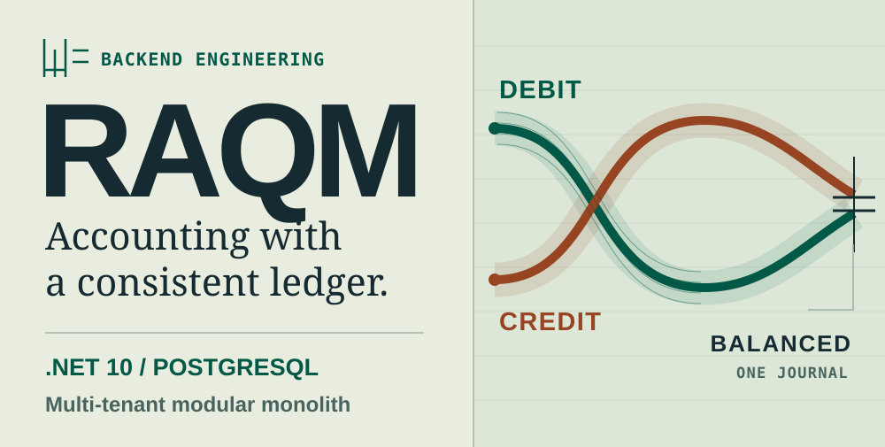
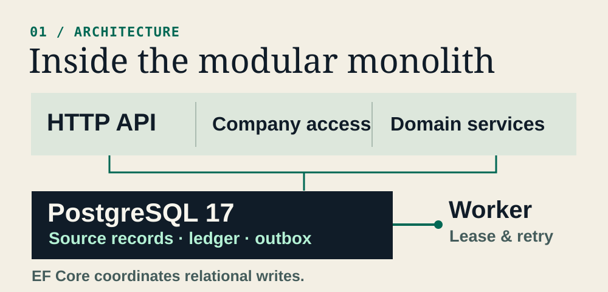
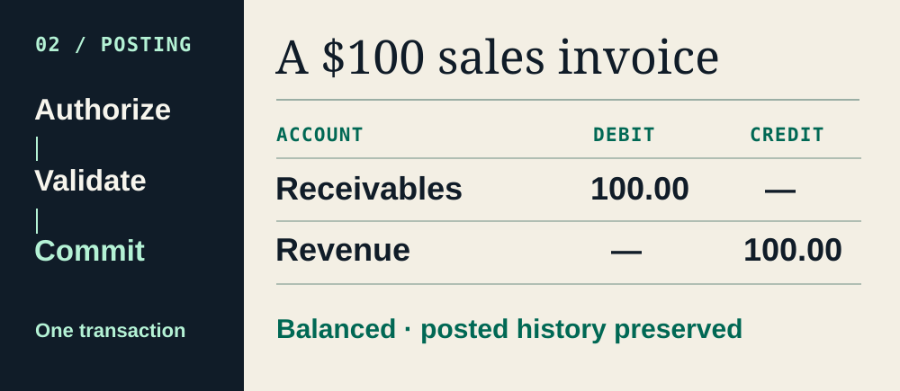
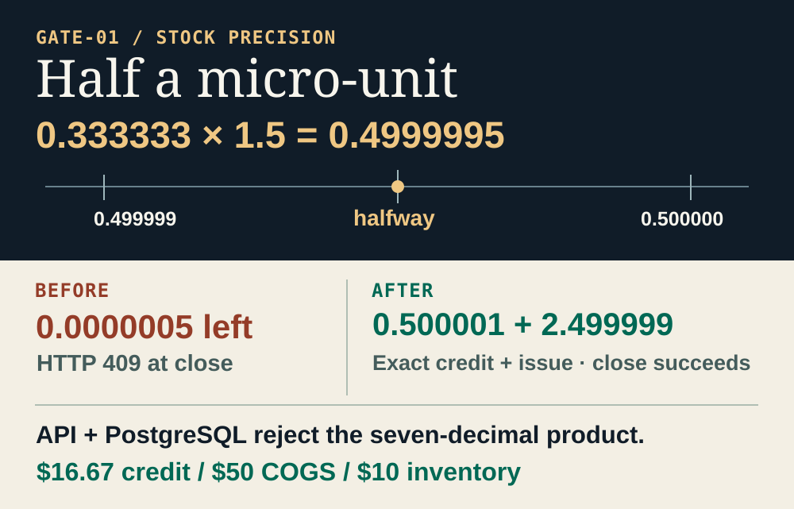
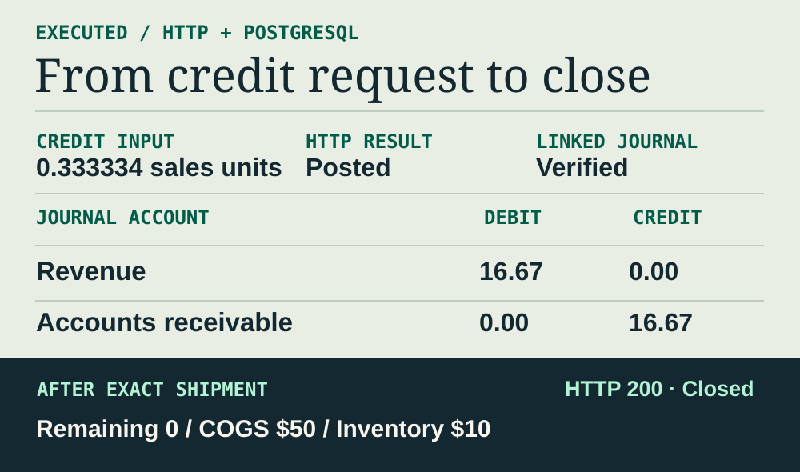
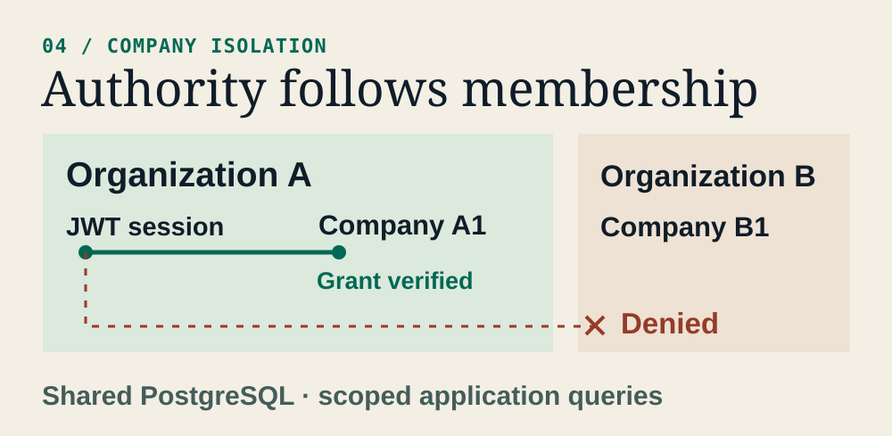

<picture>
  <source media="(prefers-color-scheme: dark)" srcset="docs/media/raqm-hero-dark.svg">
  
</picture>

# RAQM — Multi-Tenant Accounting & Financial Ledger Backend

A **.NET 10 and PostgreSQL** modular monolith by **Mohamed Samer Hizen**. RAQM connects invoices, payments, stock, and fiscal close to a company-scoped general ledger. A credit can change what a customer owes and what a warehouse may ship. Both effects must agree when requests race, retry, or fail at commit.

[Architecture](#architecture) · [Accounting](#accounting-engine) · [Case study](#engineering-case-study) · [Runtime evidence](#runtime-evidence) · [Run locally](#quick-start)

## Architecture

[](docs/media/architecture.svg)

ASP.NET Core handles HTTP and identity. Application services own workflow and company authorization. EF Core coordinates relational writes to PostgreSQL 17. The webhook worker claims persisted delivery work with expiring leases and fences completion by lease token. External receivers can see duplicate deliveries. [Architecture](docs/ARCHITECTURE.md) · [Dispatcher](RAQM.Api/Services/EventProcessing/DeliveryDispatcher.cs)

## Accounting engine

[](docs/media/posting.svg)

The posting engine checks source, period, accounts, and balance. A company-scoped transaction stages the source, journal, and applicable settlement. Deferred database checks run before commit. Eligible corrections preserve the original posted journal and link new evidence. [Posting engine](RAQM.Api/Services/Accounting/PostingEngine.cs) · [Transaction coordinator](RAQM.Api/Services/Accounting/FinancialTransaction.cs) · [Journal invariants](docs/ACCOUNTING_INVARIANTS.md)

Explore the [accounting module map](docs/DOMAIN_MAP.md) for AR/AP, banking, fixed assets, budgets, FX, tax, inventory, procurement, reporting, and close.

## Engineering case study

[](docs/media/stock-credit.svg)

A factor of 1.5 converted a credit into **0.4999995 base units**, beyond the six-decimal stock contract. Posting succeeded, but fiscal close eventually blocked on the residual. Today the application rejects that conversion and PostgreSQL independently checks the exact product before commit. A representable credit and final shipment clear fulfillment while preserving AR, revenue, inventory, and COGS.

[Read the full case study, including the competing shipment and credit timeline](docs/ENGINEERING_TOUR.md#fractional-stock-cancellation).

## Runtime evidence

[](docs/ENGINEERING_TOUR.md#captured-posting-and-close)

The test exercised the application through HTTP and checked the stored journal in disposable PostgreSQL. The selected values show the posted credit, its journal entries, and the final period state. [Capture method and exact values](docs/ENGINEERING_TOUR.md#captured-posting-and-close)

## Company isolation

[](docs/media/isolation.svg)

RAQM derives tenant scope from persisted organization membership and requires company access before querying company data. Scoped application queries and composite relationship keys protect different parts of the boundary. The database is shared. [Authorization design](docs/ARCHITECTURE.md#tenant-resolution-and-authorization) · [HTTP access tests](RAQM.Tests/WorkflowTests.cs)

## Verification

The independently reviewed source passed **227 PostgreSQL integration cases**, **219 offline cases**, and **22 forward migrations**, including populated upgrades. Release reported zero warnings and errors and EF reported no pending model changes. These are local results from **14 November 2026**. Production operational acceptance remains pending for ingress, worker recovery, revocation, alerting, restore, and capacity. [Release verification](docs/RELEASE_VERIFICATION.md) · [Operational limits](docs/release-readiness/KNOWN_LIMITATIONS.md)

## Quick start

Use PowerShell 7 and Docker with Linux containers. The API binds to loopback port 5097. The environment initializer generates local values for the blank [template](.env.example).

```powershell
./scripts/Initialize-LocalEnvironment.ps1
docker compose up -d --build
docker compose ps
```

Once the API is healthy, open the [Development OpenAPI JSON](http://localhost:5097/openapi/v1.json) or run the readiness probe. With the [.NET SDK pinned in global.json](global.json), the test script builds Release and runs the full suite against disposable PostgreSQL.

```powershell
Invoke-WebRequest http://localhost:5097/health/ready
./scripts/Test.ps1
```

[Local development guide](docs/LOCAL_DEVELOPMENT.md) · [First authenticated request](docs/LOCAL_DEVELOPMENT.md#first-authenticated-request)

## Explore the repository

- [API and workflow services](RAQM.Api) · [EF migrations](RAQM.Api/Data/Migrations) · [PostgreSQL and offline tests](RAQM.Tests)
- [Engineering case study](docs/ENGINEERING_TOUR.md) · [Domain map](docs/DOMAIN_MAP.md) · [Database design](docs/DATABASE_DESIGN.md)
- [AR/AP](docs/AR_AP_DESIGN.md) · [Financial reporting](docs/FINANCIAL_REPORTING_DESIGN.md) · [Fiscal close](docs/FINANCIAL_CLOSE_DESIGN.md)

## Author and related work

[Mohamed Samer Hizen](https://github.com/mohamedsamerhizen) · .NET backend engineering across financial workflows, API design, authorization, and integration testing.

[Relytica](https://github.com/mohamedsamerhizen/Relytica) · [DARAK](https://github.com/mohamedsamerhizen/DARAK) · [RIAYA](https://github.com/mohamedsamerhizen/RIAYA) · [ACADEMIX](https://github.com/mohamedsamerhizen/ACADEMIX)

RAQM’s folder organization takes inspiration from [Mando](https://github.com/mohamedsamerhizen/Mando) and DARAK, as recorded in the reviewed source.
