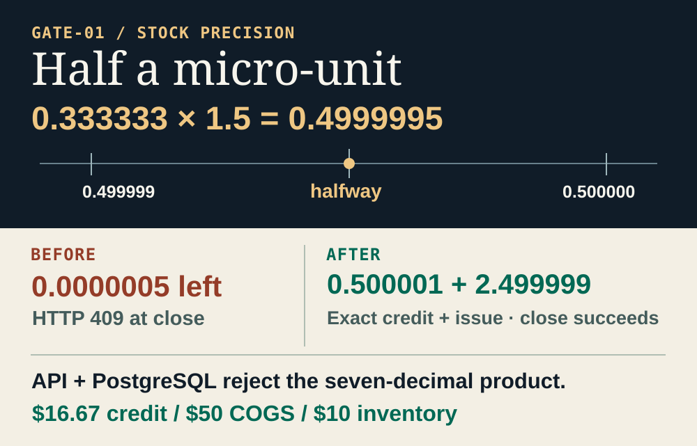
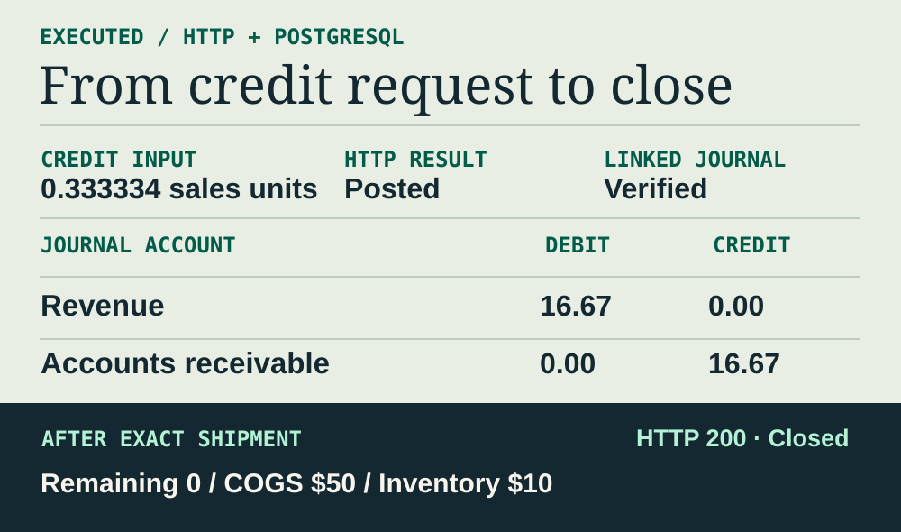
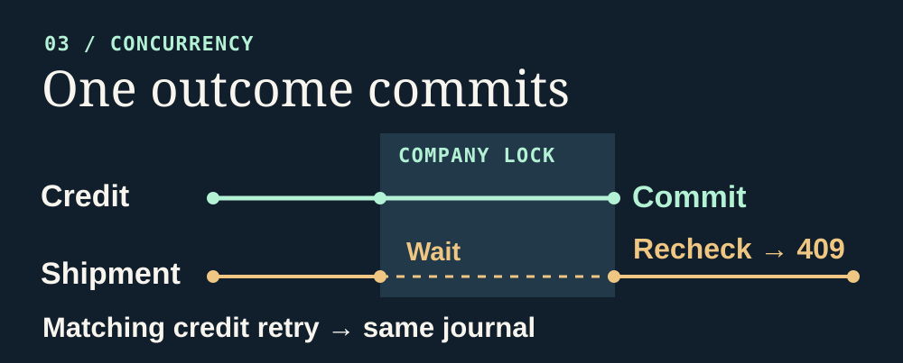

# RAQM engineering case study

[Back to overview](../README.md) · [Run locally](LOCAL_DEVELOPMENT.md)

## Fractional stock cancellation

Two sales units at $50 each represent **3 base units** at the invoice's frozen factor of **1.5**. An independently approved credit used **0.333333 sales units**. The conversion yielded **0.4999995 base units**, which could be recorded as cancellation demand in the previous implementation even though stock issues support six decimal places.

| Stage | Historical path | Accepted path |
| --- | --- | --- |
| Credit | 0.333333 × 1.5 = 0.4999995 base units | 0.333334 × 1.5 = 0.500001 base units |
| Exact remaining issue | 2.5000005 could not be issued | 2.499999 posts |
| Fulfillment | Issuing 2.5 left 0.0000005 | Zero remaining |
| Fiscal close | HTTP 409, unresolved fulfillment | Period closes |

The application validates the exact product at draft and posting. The deferred PostgreSQL journal trigger checks the same company-scoped product at commit. It tests representability by comparing the product with its six-decimal truncation. Posted quantity always uses the exact value. The valid credit debits revenue and credits AR by **$16.67**, with zero inventory movement. The issue recognizes **$50 COGS** and leaves **$10** of the **$60** opening stock value. Fully issued quantities require physical return evidence.

[Draft and posting](../RAQM.Api/Services/Trading/TradeDocumentService.cs) · [Inventory policy](../RAQM.Api/Services/Inventory/InventoryPostingPolicy.cs) · [Migration 22](../RAQM.Api/Data/Migrations/20261114160000_StockCancellationPrecision.cs) · [HTTP, journal and valuation assertions](../RAQM.Tests/InventoryIntegrationTests.cs)

Previously posted evidence remains intact. Operators can run the [read-only cancellation assessment](../scripts/StockCancellationPrecisionAudit.sql) against retained databases at migration 21 or later. The report calculates the exact outstanding amount from posted credits and issues. Any affected balance requires an approved accounting correction.

## Captured posting and close

On 14 November 2026, the stock-credit regression ran against a fresh PostgreSQL 17 instance. The application ran in the ASP.NET Core integration test host. A company Manager submitted the draft, a distinct Owner approved it, and the approved credit posted through HTTP. The test replayed the post, checked the persisted journal and balances, shipped the exact remaining quantity, and closed the period.

| Observation | Captured result |
| --- | --- |
| Invalid sales quantities | 0.333333 and 0.333335 returned HTTP 400 with `stock_quantity` |
| Valid credit | 0.333334 sales units, state **Posted**, total **$16.67** |
| Persisted credit journal | Revenue debit $16.67 and AR credit $16.67. Source link and replay journal identity verified. |
| Stock report after issuing 2.499999 | **0** remaining, **$50** COGS, **$10** carrying value |
| Fiscal close | HTTP **200** and persisted state **Closed** |

The illustration uses selected values from the HTTP responses and persisted PostgreSQL rows. Account labels follow the accounts matched to the original invoice entries in the test. Formatting was normalized and the capture omits record identifiers, fixture users, tokens, and machine details. The instrumentation ran in a temporary copy. [Accepted test source](../RAQM.Tests/InventoryIntegrationTests.cs)

## When shipment and cancellation race

The diagram shows the outcome in which the credit acquires the company lock first. The opposite ordering can let the issue win. The regression asserts exactly one success and one conflict, plus agreement between each result and its committed journal or stock movement. The credit endpoint fingerprints intent and returns the same journal on a matching retry. Changed intent for an already-posted credit conflicts. Deferred database checks preserve the cap on issued plus cancelled quantity.

[Concurrency and retry tests](../RAQM.Tests/InventoryIntegrationTests.cs) · [Company transaction](../RAQM.Api/Services/Accounting/FinancialTransaction.cs) · [Stock cancellation guard](../RAQM.Api/Data/Migrations/20261114150000_StockedSaleCancellation.cs)

## Ledger, company, and worker boundaries

- **Posting and close.** The posting engine validates source evidence and period controls. Its outer operation owns commit. A failure rolls back the unit, including any staged journal and allocation. Eligible corrections preserve original posted history. [Posting](../RAQM.Api/Services/Accounting/PostingEngine.cs) · [Close](FINANCIAL_CLOSE_DESIGN.md)
- **Company access.** Active session and persisted organization membership derive tenant scope. The selected company requires organization ownership or the appropriate grant. Composite company keys maintain relationship integrity alongside application authorization. [Authorization](ARCHITECTURE.md#tenant-resolution-and-authorization)
- **Currency and tax.** Versioned context stays attached to posted activity. Tests exercise partial settlements, revaluation, supplier credits, reverse charge, and withholding corrections. [FX cases](../RAQM.Tests/MultiCurrencyIntegrationTests.cs) · [Tax cases](../RAQM.Tests/TradingIntegrationTests.TaxAccounting.cs)
- **Delivery.** The dispatcher claims due work with `FOR UPDATE SKIP LOCKED`, can reclaim expired leases, and fences final updates by lease token. Attempts are bounded. Deployed recovery and external delivery behavior are separate operational acceptance items. [Dispatcher](../RAQM.Api/Services/EventProcessing/DeliveryDispatcher.cs) · [Supported limits](release-readiness/KNOWN_LIMITATIONS.md)

[Return to the portfolio overview](../README.md)
